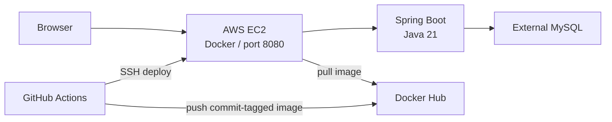
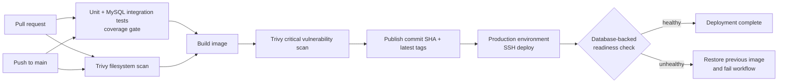

# AWS Shopping Cart — DevOps Portfolio

This repository packages a small Spring Boot shopping-cart demo and adds a reviewable DevOps workflow around it: automated tests, container health checks, security scanning, a commit-tagged CI/CD pipeline, rollback automation, and Terraform for a demo EC2 host. The application is intentionally simple; the infrastructure and delivery practices are the focus. CI configuration exists in the repository, but a successful live AWS deployment has **not** been verified by this project session.

## What this repository adds

| Area | Contribution in this repository | Verification status |
| --- | --- | --- |
| Automated checks | Service/controller unit tests, MySQL Testcontainers integration tests, JaCoCo line-coverage gate, and mocked deployment-script tests | 22 Java tests and 8 deploy-script tests passed locally; 98.46% measured line coverage |
| Container | Multi-stage Java 21 image, non-root runtime user, OCI metadata, and HTTP liveness health check | Compose startup, database readiness, HTTP page response, and non-root container verified locally |
| CI/CD | Pull-request checks, dependency/configuration scans, immutable commit-SHA image tags, production environment deploy, readiness check, rollback, and manual rollback workflow | Workflows linted; no GitHub Actions run or AWS deploy verified |
| Infrastructure as code | Terraform definition for EC2, restricted SSH ingress, encrypted root volume, IMDSv2, and a monthly budget alert | `fmt` and `validate` passed; not applied to AWS |
| Operations | Deployment runbook, architecture decisions, findings, and evidence log | Included in `docs/` |

## Scope and limitations

The original web application displays products and supports basic cart operations backed by MySQL. The home page uses a fixed sample cart ID. There is no authentication, user-specific cart selection, payment processing, inventory management, or production-ready security model.

The deployment target is one EC2 instance and one container. Container replacement can cause downtime. Terraform describes demo infrastructure, not a production VPC/database architecture; the DB remains external and must be created and secured separately. GitHub-hosted runner IPs are not suitable for a small fixed SSH allowlist; use a controlled static-egress runner or redesign the deployment around AWS Systems Manager rather than opening SSH globally.

## Architecture



## CI/CD pipeline



The workflows are configuration, not evidence that these jobs have passed on GitHub. See [`docs/EVIDENCE.md`](docs/EVIDENCE.md) for what was and was not verified.

## Run locally

Prerequisites: Java 21 and Docker Compose v2.

Start the app and MySQL:

```sh
docker compose up --build
```

Open [http://localhost:8080](http://localhost:8080). The app container waits for MySQL health. The Compose database uses a named volume; remove it only when you want to delete local demo data:

```sh
docker compose down
docker compose down -v
```

The local database credentials in `compose.yaml` are for local development only and must not be reused in AWS.

## Run checks

```sh
./gradlew --no-daemon clean test jacocoTestReport jacocoTestCoverageVerification
python3 -m unittest discover -s deploy/tests
```

The JaCoCo gate is 95% line coverage for application code excluding plain JPA entities and the application bootstrap class. Integration tests use MySQL 8.4 through Testcontainers and are skipped when Docker is unavailable; a local test run without Docker does not validate the database integration. See the [evidence log](docs/EVIDENCE.md) for measured output.

## Deploy and roll back

Deployment is configured for pushes to `main`. Before enabling it:

1. Review [the runbook](docs/RUNBOOK.md), [Terraform notes](infra/README.md), and cost/risk warnings.
2. Obtain permission to republish the original application code and select a license.
3. Configure a Docker Hub repository, an EC2 host with Docker and `curl`, an external MySQL database, and GitHub `production` environment secrets: `DOCKER_USER`, `DOCKER_TOKEN`, `EC2_HOST`, `EC2_USER`, `EC2_KEY`, `DB_URL`, `DB_USERNAME`, `DB_PASSWORD`.
4. Ensure the chosen runner can reach SSH through a narrowly scoped security rule. Do not expose SSH to `0.0.0.0/0` to make hosted CI work.
5. Configure a production environment reviewer if appropriate, then verify the first real Actions run, `/actuator/health/readiness`, `/`, and a cart operation.

Use **Actions → Manual rollback** to deploy a previously published full commit SHA. The deploy script also attempts automatic rollback to the image that was running before a failed release. Details and troubleshooting steps are in [`docs/RUNBOOK.md`](docs/RUNBOOK.md).

**Terraform is not applied by CI or by the authoring agent.** It may create billable resources. The budget notification is not a spending cap. Read [`infra/README.md`](infra/README.md), verify current pricing and free-tier eligibility, and review the plan before any owner-run apply.

## Security notes

- Never commit credentials, private keys, populated `.env` files, or Terraform state.
- GitHub Actions references are pinned to full commit SHAs; Dependabot is configured to propose updates.
- The EC2 security group limits database egress to a configured CIDR/port. TCP/443 egress remains open for Docker Hub and OS updates and is the documented Trivy AWS-0104 exception; this is not fully restricted egress.
- The deploy job passes database credentials to the remote container environment. Host administrators can inspect container configuration; treat host access as privileged and rotate credentials if exposed.
- The app has no authentication and is for demo data only. See [`SECURITY.md`](SECURITY.md).
- The Spring Boot plugin was upgraded to 4.0.9 after a local image scan identified critical vulnerabilities; rebuilding and rescanning the image found zero CRITICAL findings. The Trivy filesystem scan passed with the documented HTTPS-egress exception.
- New database initialization uses English sample data. Existing persistent MySQL volumes do not rerun the initialization script automatically; update their sample rows manually if they should match the new English catalog.
- Docker Compose and local health have been verified; GitHub workflow runs and live AWS deployment have not.

## Origin & attribution

The Java shopping-cart application originates from `daonguyendev`; the Git history credits that author for the application source. This repository has no license file, and permission to redistribute the original code has not been confirmed. Obtain permission and choose a license before publishing or sharing this repository as a public portfolio project.

| Original application | DevOps additions in this repository |
| --- | --- |
| Spring MVC / Thymeleaf shopping-cart demo, JPA entities and repositories, product/cart services, and MySQL schema/seed | Automated tests and coverage gate; Testcontainers MySQL integration suite; Docker health check and local Compose setup; CI/CD and image scans; health-checked EC2 deployment with automatic/manual rollback; Terraform demo infrastructure; runbook, decisions, findings, and evidence documentation |

## Project documentation

- [Findings and known application limitations](docs/FINDINGS.md)
- [Architecture decision records](docs/DECISIONS.md)
- [Deployment runbook](docs/RUNBOOK.md)
- [Verification evidence and owner-only TODOs](docs/EVIDENCE.md)
- [Terraform setup and cost warning](infra/README.md)
